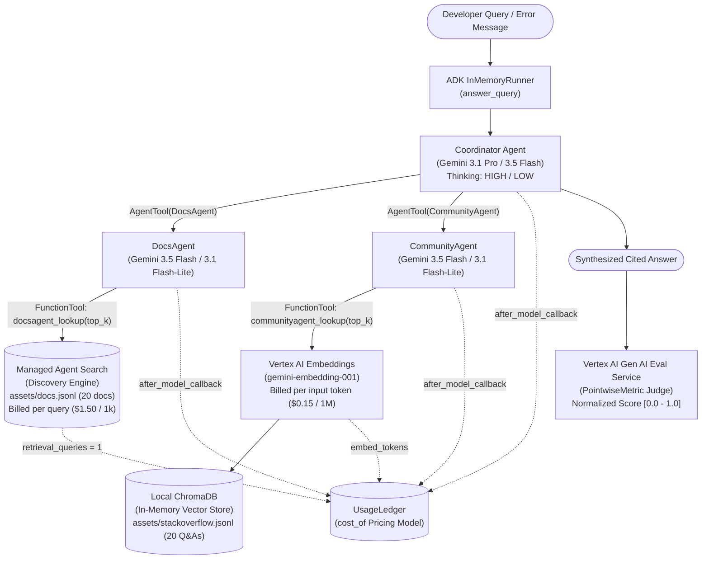

# Code Assistant Agent: Measure & Optimize the Cost of a Multi-Agent Code Assistant (ADK)

An end-to-end engineering guide, reference architecture, and runnable lab repository for **Measuring & Optimizing the Cost of a Multi-Agent Code Assistant** built on the **Google Agent Development Kit (ADK)**, **Gemini 3 Family Models**, **Managed Agent Search (Discovery Engine)**, **ChromaDB**, and the **Vertex Gen AI Evaluation Service**.

---

## Table of Contents

1. [Executive Summary & Problem Statement](#1-executive-summary--problem-statement)
2. [System Architecture & Multi-Agent Workflow](#2-system-architecture--multi-agent-workflow)
3. [Repository Structure](#3-repository-structure)
4. [Core Concepts & Cost Engineering Framework](#4-core-concepts--cost-engineering-framework)
   - [4.1 The Usage Ledger & Cost Attribution Contract](#41-the-usage-ledger--cost-attribution-contract)
   - [4.2 Reference-Anchored LLM-as-a-Judge Quality Evaluation](#42-reference-anchored-llm-as-a-judge-quality-evaluation)
   - [4.3 Lever 1: Model Selection & Tiering (Pro vs. Flash vs. Flash-Lite)](#43-lever-1-model-selection--tiering-pro-vs-flash-vs-flash-lite)
   - [4.4 Lever 2: Explicit & Implicit Context Caching](#44-lever-2-explicit--implicit-context-caching)
   - [4.5 Lever 3: Reasoning ("Thought") Token & Retrieval Breadth (`top_k`) Reduction](#45-lever-3-reasoning-thought-token--retrieval-breadth-top_k-reduction)
   - [4.6 Bonus Lever: Semantic Response Caching](#46-bonus-lever-semantic-response-caching)
5. [Codebase Deep Dive](#5-codebase-deep-dive)
6. [Step-by-Step Running Manual](#6-step-by-step-running-manual)
   - [Prerequisites](#prerequisites)
   - [Step 1: Environment Setup & Lab Files](#step-1-environment-setup--lab-files)
   - [Step 2: Install Dependencies & Configure Project](#step-2-install-dependencies--configure-project)
   - [Step 3: Provision Managed Agent Search & ChromaDB](#step-3-provision-managed-agent-search--chromadb)
   - [Step 4: Run Part 1 — Baseline Measurement](#step-4-run-part-1--baseline-measurement)
   - [Step 5: Run Part 2 — Model Selection & Tiering](#step-5-run-part-2--model-selection--tiering)
   - [Step 6: Run Part 3 — Context Caching](#step-6-run-part-3--context-caching)
   - [Step 7: Run Part 4 — Reasoning & Retrieval Token Reduction](#step-7-run-part-4--reasoning--retrieval-token-reduction)
   - [Step 8: Run Part 5 — Compare Configurations & Semantic Cache](#step-8-run-part-5--compare-configurations--semantic-cache)
   - [Step 9: Run Part 6 — Graded Final Challenge & Solution](#step-9-run-part-6--graded-final-challenge--solution)
7. [Final Challenge Results & Cost Breakdown](#7-final-challenge-results--cost-breakdown)

---

## 1. Executive Summary & Problem Statement

Agentic applications drive significant model and service costs in production. Unlike a single-turn LLM prompt, a single developer question in a multi-agent system fans out into:
- Repeated **Coordinator** orchestration turns
- Multiple **Sub-Agent** tool invocations (each requiring a tool-decision turn and a synthesis turn)
- **Managed Search** queries (billed per search request) and **Vector Database** lookups (billed per embedded token)
- Thousands of hidden **reasoning ("thought") tokens** billed at the model's full **output token rate**

Teams frequently deploy multi-agent systems without knowing what a single answer costs—or worse, slash costs aggressively with tiny models and hard token caps that silently destroy answer quality.

**The Engineering Goal:**
1. **Attribute every billable event** using an in-memory `UsageLedger` and a published pricing contract (`cost_of`).
2. **Score every configuration** against a reference-anchored LLM Judge (`run_quality_eval`) normalized to `[0, 1]`.
3. **Apply optimization levers systematically** (change one dial at a time, measure both cost and quality).
4. **Pass the Production Challenge** on 16 held-out developer queries:
   - **Cost Budget:** $\le \$0.0135\text{ USD}$ per query (roughly 50% below baseline)
   - **Quality Floor:** $\ge 0.90$ mean correctness/completeness score

---

## 2. System Architecture & Multi-Agent Workflow



### How One Query Executes Under the Hood
When a user asks a question, the ADK `Coordinator` uses `AgentTool(sub_agent)` (rather than sub-agent handoff/transfer) so control always returns to the Coordinator for final citation synthesis:
1. **Coordinator Call #1 (Routing/Tool Selection):** Reads the user query, thinks (`thought_tokens`), and emits tool calls to `DocsAgent` and/or `CommunityAgent`.
2. **DocsAgent Call #1 (Tool Decision):** Decides to call `docsagent_lookup` with a search query.
3. **Agent Search Lookup:** Queries Google Cloud Discovery Engine (`code_assistant-docs-engine`), retrieves top `top_k` official doc snippets, and logs `1` `vais_query` event to `UsageLedger`.
4. **DocsAgent Call #2 (Sub-agent Synthesis):** Reads the retrieved doc snippets and summarizes the official documentation answer.
5. **CommunityAgent Call #1 (Tool Decision):** Decides to call `communityagent_lookup`.
6. **Embedding + ChromaDB Lookup:** Calls `gemini-embedding-001` to embed the search string (logging `embed_tokens` to `UsageLedger`) and queries the local ChromaDB collection (`stackoverflow.jsonl`) for `top_k` community posts.
7. **CommunityAgent Call #2 (Sub-agent Synthesis):** Summarizes the community discussion.
8. **Coordinator Call #2 (Final Synthesis):** Reads the responses from both sub-agents, thinks (`thought_tokens`), and writes a single concise answer citing both official docs and community discussions.

> **Key Insight:** A single user query triggers **6 LLM calls** (2 Coordinator + 2 DocsAgent + 2 CommunityAgent), **1 Embedding API call**, and **1 Managed Agent Search query**!

---

## 3. Repository Structure

```text
.
├── README.md                                  # Complete architectural guide & step-by-step manual
├── code_assistant_cost_optimization.ipynb     # Main interactive lab notebook (Parts 0 - 6 completed)
├── run_challenge.py                           # Standalone script to execute Part 6 Final Challenge
├── final_metrics.json                         # Verified PASS output metrics from the held-out evaluation
├── notebook_config.sh                         # Startup script that populates /home/jupyter on Workbench
├── code_assistant/                            # Core Python package powering the multi-agent system
│   ├── __init__.py                            # Package docstring
│   ├── agents.py                              # ADK Coordinator & Sub-Agent definitions + UsageLedger callbacks
│   ├── data.py                                # JSONL dataset loader (load_jsonl)
│   ├── display.py                             # HTML metric cards and PASS/FAIL banner renderers
│   ├── ledger.py                              # UsageLedger container for per-query & per-component cost attribution
│   ├── quality.py                             # Vertex AI EvalTask wrapper + custom correctness/completeness rubric
│   ├── retrieval.py                           # Vertex AI embedding client + ChromaDB in-memory vector index
│   └── vais.py                                # Discovery Engine (Agent Search) provisioning & search tool
└── assets/                                    # Grounding corpora & evaluation datasets
    ├── docs.jsonl                             # 20 official Python error documentation notes (indexed in Agent Search)
    ├── stackoverflow.jsonl                    # 20 Stack Overflow Q&A posts (indexed in local ChromaDB)
    ├── eval_dataset.jsonl                     # 15 development queries + reference answers (used in Parts 1-5)
    └── eval_holdout.jsonl                     # 16 held-out queries + reference answers (used in Part 6 grading)
```

---

## 4. Core Concepts & Cost Engineering Framework

### 4.1 The Usage Ledger & Cost Attribution Contract

You cannot optimize what you cannot attribute. The notebook defines the published pricing table (`PRICING`) and `cost_of(record)` function, which is injected into `UsageLedger`:

| Component / Model | Input ($ / 1M tokens) | Cached Input ($ / 1M tokens) | Output & Thought ($ / 1M tokens) | Flat / Token Unit Rate |
| :--- | :---: | :---: | :---: | :---: |
| `gemini-3.1-pro-preview` | `$2.00` | `$0.20` | `$12.00` | — |
| `gemini-3.5-flash` | `$1.50` | `$0.15` | `$9.00` | — |
| `gemini-3.1-flash-lite` | `$0.25` | `$0.025` | `$1.50` | — |
| `gemini-embedding-001` | — | — | — | `$0.15` per 1M input tokens |
| `vais_query` (Agent Search) | — | — | — | `$1.50` per 1,000 queries (`$0.0015`/query) |

**Crucial Billing Rules Implemented in `cost_of()` and `_model_cb()`:**
1. **Thought Tokens Bill as Output Tokens:** Reasoning tokens (`thoughts_token_count`) are added to `candidates_token_count` and billed at the **output rate** (`$12.00/1M` on Pro, `$9.00/1M` on Flash).
2. **Disjoint Cached Token Accounting:** Vertex AI's `prompt_token_count` *includes* `cached_content_token_count`. To prevent double-charging, `_model_cb` records:
   - `input_tokens = max(0, prompt_token_count - cached_content_token_count)`
   - `cached_tokens = cached_content_token_count`
3. **Unbounded Generation Ceilings (`max_output_tokens`):** To protect against runaway generation loops, `agents.py` enforces safety ceilings of `2,048` tokens for sub-agents and `3,072` tokens for the Coordinator.

---

### 4.2 Reference-Anchored LLM-as-a-Judge Quality Evaluation

Cost reduction is meaningless if the agent starts hallucinating or dropping answers to multi-part questions. In `code_assistant/quality.py`, quality is evaluated using Vertex AI's `EvalTask` and `PointwiseMetric` against two strict criteria:
- **Correctness:** *"The response's technical claims and recommended fixes agree with the reference answer. It contains no claim that contradicts the reference."*
- **Completeness:** *"The response covers the essential points of the reference answer; for multi-part questions, it addresses every part."*

The judge assigns an integer score from `1` to `5`, which `run_quality_eval` normalizes to `[0.0, 1.0]` via:
$$\text{Quality Score} = \frac{\text{Mean Rating} - 1}{4}$$
- A mean rating of `5.0` maps to `1.00`.
- A mean rating of `4.6` maps to `0.90` (the Final Challenge quality floor).
- Note: Judge API calls are measurement overhead and are intentionally excluded from the agent's `UsageLedger`.

---

### 4.3 Lever 1: Model Selection & Tiering (Pro vs. Flash vs. Flash-Lite)

In **Part 1 (Baseline)**, the Coordinator runs on `gemini-3.1-pro-preview` (`HIGH` thinking) and sub-agents run on `gemini-3.5-flash`.
- Baseline cost is **~`$0.026` per query**, dominated by the Coordinator's Pro-priced output and thought tokens.

In **Part 2 (Model Tiering)**, we hold thinking pinned at `HIGH` and step down the Coordinator's model tier:
- **Step 1a (`gemini-3.5-flash` Coordinator @ `HIGH`):** Drops cost by **25%–40%** while keeping quality around `~0.90+`. Flash has both a lower per-token rate *and* naturally uses fewer thought tokens for the same task. This is a **near-free win**.
- **Step 1b (`gemini-3.1-flash-lite` Coordinator @ `HIGH` — The Cautionary Trap):** Although `gemini-3.1-flash-lite` is 6x cheaper per token than Flash, pairing a compact budget model with `HIGH` reasoning effort on complex multi-agent orchestration leads to **wild cost and quality instability** (`$0.007` to `$0.048` per query, malformed tool calls, and degraded synthesis).
- **Architectural Rule:** Never use `gemini-3.1-flash-lite` for the Coordinator seat. However, **sub-agents (`DocsAgent` and `CommunityAgent`) perform narrow, single-tool summarization**—making them ideal candidates for `gemini-3.1-flash-lite`!

---

### 4.4 Lever 2: Explicit & Implicit Context Caching

In **Part 3**, we examine **Context Caching**:
- Cached input tokens are billed at **10% of the standard input rate** (`$0.15/1M` vs. `$1.50/1M` on `gemini-3.5-flash` — a **90% input discount**).
- **When it applies:** Explicit context caching (`client.caches.create`) requires a minimum stable prefix of **4,096 tokens** for Gemini 3 models (such as a large system prompt, product manual, or multi-turn trajectory).
- **Why it isn't in the Coordinator scorecard:** Code Assistant Agent's system instruction is only ~150 tokens, below the 4,096-token threshold. Part 3 demonstrates the 90% input cost reduction on a 700x repeated instruction prefix (~8,400 tokens).

---

### 4.5 Lever 3: Reasoning ("Thought") Token & Retrieval Breadth (`top_k`) Reduction

In **Part 4**, we tune two token-volume dials on top of the `gemini-3.5-flash` Coordinator:
1. **Step 3a — Thinking Effort (`thinking_level="LOW"` vs. `"HIGH"`):**
   - Because thought tokens are billed at the expensive output rate (`$9.00/1M` on Flash), lowering `thinking_level` from `"HIGH"` to `"LOW"` drastically collapses the Coordinator's `thought_tokens` without hurting accuracy on grounded Q&A synthesis, cutting cost by another **15%–35%**.
2. **Step 3b — Retrieval Breadth (`top_k=2` vs. `3`):**
   - Trims how many document snippets `DocsAgent` and `CommunityAgent` paste into their prompts.
   - This provides a modest input-token saving on sub-agents, though flat per-query Agent Search fees (`$0.0015`/query) remain unchanged.
3. **Why `max_output_tokens` (`MY_MAXOUT`) is a Blunt Instrument:**
   - Setting a tight `max_output_tokens` cap shares the budget between `thought_tokens` and `output_tokens`. Since the model spends thought tokens *first*, a tight cap starves and truncates the actual answer, tanking the quality score. Leave `MY_MAXOUT = None` (which keeps the safe `3,072` ceiling).

---

### 4.6 Bonus Lever: Semantic Response Caching

In **Part 5 (Bonus)**, `SemanticCache` demonstrates how to bypass the entire multi-agent pipeline on recurring developer questions:
1. Embed the incoming query with `gemini-embedding-001` (fractions of a cent).
2. Compute cosine similarity against previously answered queries:
   $$\cos(\theta) = \frac{\mathbf{a} \cdot \mathbf{b}}{\|\mathbf{a}\| \|\mathbf{b}\|}$$
3. If similarity $\ge \text{threshold}$ (`0.85`), return the cached answer immediately (**4 orders of magnitude cheaper** than running the 6-call agent pipeline).
4. Otherwise, on a cache miss, run the full pipeline and store `(embedding, answer)` for future queries.

---

## 5. Codebase Deep Dive

- **`code_assistant/agents.py`**:
  - `build_code_assistant(...)`: Constructs `DocsAgent`, `CommunityAgent`, and `Coordinator` using `google.adk.agents.Agent`, wraps sub-agents in `AgentTool`, attaches `after_model_callback` (`_model_cb`) to log token usage per agent, and configures `types.ThinkingConfig(thinking_level=...)`.
  - `answer_query(...)`: Runs a query through `google.adk.runners.InMemoryRunner`, manages async event loops inside Jupyter via `_resolve()`, and captures thread exceptions via `_quiet_adk_thread_errors`.
- **`code_assistant/vais.py`**:
  - `ensure(...)` & `provision(...)`: Idempotently provisions a Google Cloud Discovery Engine (`discoveryengine_v1`) `GENERIC` Data Store (`code_assistant-docs`), imports the 20 JSONL docs inline, provisions a `SEARCH_TIER_STANDARD` Engine (`code_assistant-docs-engine`), and waits until searchable.
  - `make_vais_lookup_tool(...)`: Creates the ADK `FunctionTool` for `DocsAgent` and records `call_type="retrieval", model="vais_query", retrieval_queries=1` in the `UsageLedger`.
- **`code_assistant/retrieval.py`**:
  - `embed_texts(...)`: Calls Vertex AI `client.models.embed_content` with `HttpRetryOptions` and records `embed_tokens` in the `UsageLedger`.
  - `build_index(...)`: Builds an in-memory `chromadb.EphemeralClient()` collection over `assets/stackoverflow.jsonl`.
  - `make_lookup_tool(...)`: Creates the ADK `FunctionTool` for `CommunityAgent`.
- **`code_assistant/ledger.py`**:
  - `UsageLedger`: Stores billing records, computes `total_cost()`, `cost_per_query()` (excluding `__index__` build events), and `cost_breakdown()` grouped by agent name.
- **`code_assistant/quality.py`**:
  - `run_quality_eval(...)`: Evaluates agent answers against reference answers using `vertexai.evaluation.EvalTask` and normalizes the 1–5 rubric mean to `[0, 1]`.

---

## 6. Step-by-Step Running Manual

### Prerequisites
- A Google Cloud Project with **Vertex AI API** and **Discovery Engine API (Agent Search)** enabled.
- Python 3.10+ (or a **Vertex AI Workbench / Agent Platform Workbench** `generative-ai-jupyterlab` instance).

### Step 1: Environment Setup & Lab Files
If running on Google Cloud Workbench or Cloud Shell, ensure the repository files (`code_assistant_cost_optimization.ipynb`, `code_assistant/`, `assets/`) are in your working directory:
```bash
# If copying from the Qwiklabs source bucket:
gcloud storage cp -r "gs://<YOUR_LAB_BUCKET>/*" ~/
cd ~/
```

### Step 2: Install Dependencies & Configure Project
Install the required packages (or run the first cell of `code_assistant_cost_optimization.ipynb`):
```bash
pip install -q google-adk==2.3.0 \
  "google-cloud-aiplatform[evaluation]>=1.158.0" \
  "google-genai>=2.10.0" \
  "chromadb>=1.5.9" \
  "google-cloud-discoveryengine>=0.20.0" \
  pandas matplotlib
```
Set your Google Cloud environment variables:
```python
import os

PROJECT = "your-gcp-project-id"  # Automatically detected via gcloud in the notebook
LOCATION = "global"  # Gemini 3 family serves from the global endpoint
EVAL_LOCATION = "us-central1"  # Vertex Gen AI evaluation service is regional
os.environ.update(
    GOOGLE_GENAI_USE_VERTEXAI="TRUE",
    GOOGLE_CLOUD_PROJECT=PROJECT,
    GOOGLE_CLOUD_LOCATION=LOCATION,
)
```

### Step 3: Provision Managed Agent Search & ChromaDB
Run the **Part 0: Provision retrieval and assemble the agent** cell in the notebook:
```python
VAIS_LOCATION, DS_ID, ENGINE_ID = (
    "global",
    "code_assistant-docs",
    "code_assistant-docs-engine",
)
DOCS_SC = vais.ensure(
    PROJECT, VAIS_LOCATION, DS_ID, ENGINE_ID, load_jsonl("assets/docs.jsonl")
)
community = build_index(
    load_jsonl("assets/stackoverflow.jsonl"),
    "gemini-embedding-001",
    PROJECT,
    LOCATION,
    name="community",
)
```
- **First run:** Takes ~2–4 minutes to create the data store, import the 20 documents, create the search engine, and wait until the index responds to the `"KeyError"` probe.
- **Subsequent runs:** Detects the existing engine and reuses it in seconds.

### Step 4: Run Part 1 — Baseline Measurement
Run the **Part 1: Baseline** cell to evaluate all 15 queries in `assets/eval_dataset.jsonl` using:
- Coordinator: `gemini-3.1-pro-preview` (`thinking_level="HIGH"`)
- Sub-agents: `gemini-3.5-flash`
- Retrieval `top_k`: `3`
- **Expected Result:** Cost is **~`$0.026` per query**, quality is **~`0.90+`**, and the component bar chart confirms the **Coordinator** dominates the total spend.

### Step 5: Run Part 2 — Model Selection & Tiering
1. **Run Lever 1a (`gemini-3.5-flash` Coordinator @ `HIGH`):** Observe cost drop by 25–40% while maintaining baseline quality.
2. **Run Lever 1b (`gemini-3.1-flash-lite` Coordinator @ `HIGH`):** Observe high variance in thought tokens and tool stability, demonstrating why the Coordinator seat requires at least `gemini-3.5-flash`.

### Step 6: Run Part 3 — Context Caching
Run the **Part 3: Context caching** cell to create a 120-second `CachedContent` resource over an 8,400-token system instruction prefix and verify a **~90% reduction** in input token cost.

### Step 7: Run Part 4 — Reasoning & Retrieval Token Reduction
1. **Run Lever 3a (`thinking_level="LOW"` on `gemini-3.5-flash` Coordinator):** Watch `thought_tokens` drop dramatically, reducing cost by another 15–35% while maintaining quality.
2. **Run Lever 3b (`top_k=2` + `thinking_level="LOW"`):** Trims sub-agent prompt context from 3 snippets to 2 snippets per lookup.

### Step 8: Run Part 5 — Compare Configurations & Semantic Cache
Run the **Part 5** cells to generate:
- The comparative DataFrame (`cost_vs_baseline`, `quality_vs_baseline`) and Pareto scatter plot (Cost vs. Quality).
- The grouped bar chart comparing component spend (`Coordinator`, `DocsAgent`, `CommunityAgent`) across versions.
- The standalone `SemanticCache` hit/miss demonstration.

### Step 9: Run Part 6 — Graded Final Challenge & Solution

#### Why the Naive Lever Combination Falls Short
If you only apply the levers taught on the Coordinator (`coordinator="gemini-3.5-flash"`, `thinking_level="LOW"`, `top_k=2`) while leaving `DocsAgent` and `CommunityAgent` on `gemini-3.5-flash`, the cost per query lands around **`$0.0145–$0.0160`**, which **exceeds** the strict `$0.0135` budget!

#### The Winning Optimization Strategy
Look at the architectural constraints and per-agent breakdown:
1. **Coordinator (`"gemini-3.5-flash"`):** Must be Pro or Flash. We choose `gemini-3.5-flash`.
2. **Sub-Agents (`"gemini-3.1-flash-lite"`):** Sub-agents are **unrestricted**! Because `DocsAgent` and `CommunityAgent` only call a single lookup tool and summarize 2 short text snippets (and use `0` thought tokens), tiering both sub-agents down from `gemini-3.5-flash` (`$1.50/$9.00` per 1M) to `gemini-3.1-flash-lite` (`$0.25/$1.50` per 1M — **6x cheaper**) slashes sub-agent token spend by ~83% without degrading synthesis quality!
3. **Thinking Level (`"LOW"`):** Keeps Coordinator reasoning overhead minimal while preserving multi-part answer completeness.
4. **Retrieval Breadth (`top_k = 2`):** Keeps input context lean while providing sufficient official doc and community grounding.
5. **Output Ceiling (`MY_MAXOUT = None`):** Prevents answer truncation.

#### Exact Code for Part 6 (`code_assistant_cost_optimization.ipynb` / `run_challenge.py`)
```python
MY_MODELS = {
    "coordinator": "gemini-3.5-flash",
    "docs": "gemini-3.1-flash-lite",
    "community": "gemini-3.1-flash-lite",
    "embedding": "gemini-embedding-001",
}
MY_THINKING = "LOW"
MY_TOPK = 2
MY_MAXOUT = None
```

You can run the final challenge either inside JupyterLab (by executing the Part 6 cells) or directly from the terminal using the included script:
```bash
python3 run_challenge.py
```

---

## 7. Final Challenge Results & Cost Breakdown

Running the optimized configuration across the 16 held-out queries in `assets/eval_holdout.jsonl` achieved a green **PASS** verdict on the first run:

```json
{
  "cost_per_query": 0.010977140625,
  "quality": 0.9375,
  "budget": 0.0135,
  "quality_floor": 0.9,
  "passed": true
}
```

### Per-Agent Spend Breakdown Across All 16 Held-Out Queries

| Agent | Model Tier | Input Tokens | Thought Tokens | Output Tokens | Total Cost (16 Queries) | Avg Cost / Query |
| :--- | :--- | :---: | :---: | :---: | :---: | :---: |
| **Coordinator** | `gemini-3.5-flash` (`LOW` thinking) | `15,844` | `4,565` | `9,336` | `$0.148875` | `$0.009305` |
| **DocsAgent** | `gemini-3.1-flash-lite` + Agent Search | `4,176` | `0` | `2,551` | `$0.019870` | `$0.001242` |
| **CommunityAgent** | `gemini-3.1-flash-lite` + ChromaDB | `3,309` | `0` | `4,031` | `$0.006889` | `$0.000431` |
| **Total** | — | **`23,329`** | **`4,565`** | **`15,918`** | **`$0.175634`** | **`$0.010977`** |

- **Cost per query:** `$0.0110` (**18.7% below** the `$0.0135` budget and **~58% below** the `$0.0260` baseline)
- **Quality score:** `0.9375` (**+0.0375 above** the `0.90` quality floor)
